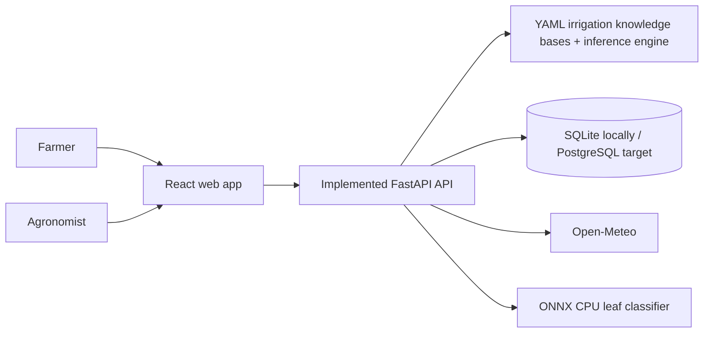

# AgriSense

AgriSense is a decision-support project for farmers. Its first implemented module provides explainable smart-irrigation recommendations; the broader specification also describes crop-disease diagnosis and agronomist review.

> **Current status:** Phases 0–3 are complete. The React frontend, irrigation backend, trained four-class ONNX model, and authenticated raw disease-inference endpoint are present. Disease-rule fusion, confidence bands, review/feedback workflows, CI, and deployment remain unfinished. There are no live service URLs.

## Implemented capabilities

- FastAPI with JWT bearer authentication, Argon2id password hashing, farmer/agronomist roles, consent logging, and account deletion.
- Farmer-owned field management and sensor readings, including CSV import and reading history.
- Open-Meteo weather lookup with a graceful fallback to the latest reading when the service or field coordinates are unavailable.
- YAML-driven irrigation knowledge bases v1 and v2, forward-chaining inference, fired-rule explanations, decision history, and manual overrides.
- Versioned irrigation knowledge-base retrieval and updates by an agronomist.
- SQLAlchemy 2 models and an Alembic initial migration for SQLite locally and PostgreSQL in deployment.
- CPU-only ONNX Runtime inference for Leaf Blight, Rust, Powdery Mildew, and Healthy, with the model and matching labels under `backend/app/ml/`.
- Authenticated `POST /fields/{field_id}/diagnose` with ownership checks, a 5 MiB upload cap, per-user upload rate limiting, image normalization, and sanitized thumbnail storage. It returns the raw model prediction; disease-rule fusion and human review are not part of this endpoint yet.

The full technical requirements remain in [docs/SPEC.md](docs/SPEC.md), and [docs/PROGRESS.md](docs/PROGRESS.md) records completed work, verification, and known limitations.

## Architecture



## Repository layout

- `backend/app/` — FastAPI routes, configuration, security, SQLAlchemy models, irrigation engine, and ONNX disease inference.
- `backend/alembic/` — initial database migration and Alembic configuration.
- `backend/tests/` — API, security, ownership, versioning, and irrigation tests.
- `docs/SPEC.md` — complete requirements; `docs/openapi.json` — generated API contract.
- `frontend/` — React farmer workspace; `ml/` — training notebook/script and model evaluation reports.
- `scripts/` and `.github/workflows/` — project setup and CI scaffolding.
- `AGENTS.md` and `GEMINI.md` — project guidance for Codex and Antigravity.

## Run the backend locally

Requires Python 3.11 or newer. These commands run from the repository root and do not require Docker.

### macOS

```sh
cd backend
python3 -m venv .venv
source .venv/bin/activate
python -m pip install -r requirements.txt
export JWT_SECRET="$(python -c 'import secrets; print(secrets.token_urlsafe(48))')"
alembic upgrade head
uvicorn app.main:app --reload
```

### Windows PowerShell

```powershell
Set-Location backend
py -3 -m venv .venv
.\.venv\Scripts\Activate.ps1
python -m pip install -r requirements.txt
$env:JWT_SECRET = (python -c "import secrets; print(secrets.token_urlsafe(48))")
alembic upgrade head
uvicorn app.main:app --reload
```

The local database defaults to `backend/agrisense.db`. Settings load the repository-root `.env` when present. Use `.env.example` as the variable-name reference, set a private `JWT_SECRET`, and never commit `.env`. The first account matching `ADMIN_EMAIL` is promoted to agronomist.

Once the API is running, interactive documentation is at `http://127.0.0.1:8000/docs`; the generated contract is [docs/openapi.json](docs/openapi.json).

Run backend tests from `backend/`:

```sh
python -m pytest -q
```

The backend test suite passed 40 tests after the inference integration. The previous audit also verified the SQLite migration cycle and generated PostgreSQL migration DDL. No live PostgreSQL deployment has been tested.

## Available API areas

Authentication and current-user management; field CRUD; manual and CSV readings; weather; irrigation decisions, history, and overrides; irrigation knowledge-base retrieval/versioning; `POST /fields/{field_id}/diagnose` (raw model inference); `/health`; and `/about/system`.

Disease-rule fusion, confidence-band assignment, diagnosis feedback/history/review APIs, agronomist review queue, and analytics remain unimplemented. The current endpoint stores and returns the CNN result only. Review [docs/PROGRESS.md](docs/PROGRESS.md) and the limitations page before using model results.

## Roadmap

| Phase | Scope | Status |
|---|---|---|
| 0 | Project structure, rules, specification, environment example, and Git foundation | Complete |
| 1 | Backend, irrigation expert system, migrations, tests, and OpenAPI contract | Complete |
| 2 | Frontend and integration | Complete |
| 3 | Crop-disease model training | Complete; supplied run artifacts included |
| 4 | Disease inference and diagnosis workflows | In progress; raw inference endpoint only |
| 5 | Frontend integration and browser verification | Not started |
| 6 | Cross-platform CI and deployment configuration | Not started |
| 7 | Deployment and live smoke test | Not started |
| 8 | Final report and viva preparation | Not started |

Codex is assigned backend and CI work; Antigravity is assigned frontend work. Keep changes within the folder named by each task, use `docs/openapi.json` as the frontend/backend contract, and update `docs/PROGRESS.md` after each phase.
